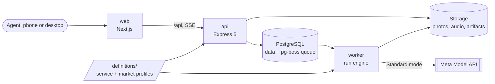

<p align="center">
  <picture>
    <source media="(prefers-color-scheme: dark)" srcset="apps/web/public/brand/evidomo-lockup-dark.svg" />
    
  </picture>
</p>

# Evidomo

**Evidence for every home.** The listing pack that can't make things up.

Evidomo turns a real estate agent's raw property photos and voice walkthrough into a verified, publication-ready listing pack in the buyer's language. Every factual claim in the pack links to the evidence it came from: a form field, a moment in the recording, or a region of a photo. A claim without a source does not get through, and that rule is enforced in code, not by a prompt.

It is built for independent agents and small offices selling residential resale properties (apartments and houses). The agent captures photos and a walkthrough on site from a phone, confirms the facts, and reviews the result at two human gates. Evidomo never gives valuations or legal advice, never publishes to portals, and never hides defects.


> **Hackathon project.** Evidomo was built from scratch during the [Meta Global AI Developer Hackathon](https://cerebralvalley.ai/e/meta-ai-developer-hackathon) (October 26 – November 4, 2026). All code in this repository was written during the event.

## How it works

1. **Capture.** Take photos and record a voice walkthrough in the browser, or upload existing files. Photos are downscaled in the browser and stripped of metadata (including GPS) on upload.
2. **Confirm facts.** A structured form, generated from the selected market profile, is the source of truth.
3. **Run.** The service transcribes the walkthrough, extracts candidate facts, inventories the photos, and reconciles everything into a Verified Fact Sheet.
4. **Gate 1: resolve conflicts.** When the sources contradict each other (the form says 1986, the recording says 1987), the run stops until the agent decides.
5. **Generate and verify.** Listing copy and buyer Q&A are written, virtual staging variants are created and structurally checked, and a claim audit runs over the text.
6. **Gate 2: review.** The agent approves, edits, or removes every flagged claim and approves each staged image next to its original.
7. **Export.** A print-ready HTML pack (use the browser's "Save as PDF") and a structured portal-fields JSON file.

### What makes it different

- **Every claim cites its source.** The creative step returns copy as segments `{ text, fact_ids[] }`. A code-level validator rejects any segment with missing or unknown fact IDs and compares every number in the text to the cited fact exactly. This runs before any model-based check.
- **A second model audits the copy.** The verifier judges whether the cited fact actually justifies the wording, and flags superlatives, promises, exclusionary phrasing, and area-basis mistakes.
- **Humans decide at gates.** Gates are states in the run's state machine. A run cannot advance past one without a recorded decision.
- **Staged images are honest.** Every staged image is labelled "Virtually staged", shown next to the original, and checked for structural integrity (windows, doors, and radiators must not appear, vanish, or move). A failing edit is retried once, then the original is kept.
- **Privacy by default.** Faces and license plates are blurred in exported images, and a photo whose privacy check is incomplete is withheld rather than published unblurred. Deleting a project hard-deletes its materials and artifacts. Customer content only goes to Meta's Standard-mode models; the client rejects any `-contributor` model ID.
- **Cost is measured and capped.** Every model call goes into a usage ledger. A run is capped at $1.00 and a day at $5.00 by default.

The full product definition is in [docs/product.md](docs/product.md).

## Architecture



**Monorepo (npm workspaces):**

| Path              | Role                                                                                                         |
| ----------------- | ------------------------------------------------------------------------------------------------------------ |
| `apps/web`        | Next.js (Pages Router) frontend, Tailwind CSS + daisyUI, TanStack Query                                      |
| `apps/api`        | Express 5 API (`src/server.ts`) and the pg-boss worker (`src/worker.ts`), the same codebase in two processes |
| `packages/shared` | zod schemas, shared types, and the model price table                                                         |
| `definitions/`    | The listing-launch service definition and the market profiles, as versioned YAML                             |
| `fixtures/`       | Recorded Meta API responses, a synthetic demo project, and the seeded-defect eval sets (no personal data)    |
| `e2e/`            | Playwright flows                                                                                             |
| `infra/`          | Production Docker Compose file, Caddyfile, provisioning and deploy scripts                                   |

**Run engine.** Each step of a run is a job on a PostgreSQL-backed pg-boss queue (no Redis). A step's state change and the job it enqueues commit in one transaction, and an idempotency key (`run_id:step_id:attempt`) stops a duplicate attempt, so a worker restart does not re-run or re-bill a completed step. The API streams run progress to the browser over Server-Sent Events.

**Definitions and market profiles.** The service (inputs, steps, models, reasoning efforts, rubric, gates, budget) is a schema-validated YAML file loaded at boot. Country-specific rules (extra fact fields, area measurement standards, publication checklist, banned phrasing, languages) live in market profiles. Adding a market means adding a profile, not changing the pipeline.

**Storage and hosting.** Files sit on the local filesystem behind a storage interface. The production target is one EU VPS running Docker Compose (Caddy for HTTPS, web, api, worker, PostgreSQL).

**Stack.** TypeScript (strict), Node.js 24 with native type stripping for api and shared (no build step), PostgreSQL with Drizzle ORM, the Vercel AI SDK and the `openai` SDK against Meta's Responses-compatible API, sharp and ffmpeg for media, Vitest, MSW, and Playwright for tests. Details and rationale: [docs/architecture.md](docs/architecture.md).

## Meta models per step

The service definition [`definitions/services/listing-launch.v1.yaml`](definitions/services/listing-launch.v1.yaml) fixes the model and reasoning effort of each step. Efforts were chosen from measured cost and latency ([docs/model-notes.md](docs/model-notes.md)).

| #   | Step            | Model                                                   | What it does                                                                                                                                                                    |
| --- | --------------- | ------------------------------------------------------- | ------------------------------------------------------------------------------------------------------------------------------------------------------------------------------- |
| 1   | Intake          | Muse Voice Transcribe 1.0 (`DIARIZATION`)               | Transcribes the walkthrough into timestamped turns, biased with keywords from the fact form and market profile. Turn timestamps are the evidence anchors for transcript claims. |
| 2   | Fact extraction | Muse Spark 1.3, effort `low`                            | Extracts candidate facts from the transcript and form, each with a verbatim quote or form field as provenance.                                                                  |
| 3   | Vision          | Muse Spark 1.3, effort `low`, and SAM 3.1               | Spark classifies each photo (room, furnishing state, quality, cover ranking). SAM 3.1 produces privacy masks (people, license plates) and a capped set of evidence regions.     |
| 4   | Reconciliation  | Muse Wonder 1.0, effort `low` (fallback Spark `medium`) | Merges candidate facts, form, and photo evidence into the Verified Fact Sheet and a conflict list. Conflicts stop the run at Gate 1.                                            |
| 5   | Creative        | Muse Spark 1.3, `medium` (copy) and `low` (Q&A)         | Writes portal and social copy and buyer Q&A cards as claim segments with fact IDs.                                                                                              |
| 6   | Staging         | Muse Image 1.0 (built-in tools off)                     | Furnishes up to 3 empty rooms per run, one edit per photo. Customer photos are edited with every built-in tool disabled.                                                        |
| 7   | Integrity check | SAM 3.1 plus code                                       | Segments windows, doors, and radiators in the original and the edit and requires matching counts and positions. Fails the edit otherwise.                                       |
| 8   | Verification    | Muse Wonder 1.0, effort `low` (fallback Spark `medium`) | Audits claim support, superlatives and promises, exclusionary phrasing, and area-basis rules. Up to two revision loops, then remaining flags go to Gate 2.                      |
| 9   | Export          | Code only                                               | Builds the HTML pack and portal-fields JSON from the approved artifacts. Blurs faces and plates.                                                                                |

Measured cost of a typical 10 to 20 photo run is about $0.46 to $0.57 at list price (estimate in [docs/architecture.md, section 10](docs/architecture.md#10-cost-controls)); two full live runs on a 20-photo set and an 11-photo synthetic set were measured at $0.5905 and $0.4655. These are list price times the units the API reported; Meta's billing dashboard was not checked.

## Eval results

Evidomo ships a seeded-defect evaluation (`npm run eval`). It plants known problems into synthetic inputs and measures whether the pipeline catches them:

- **Planted conflicts:** the fact form disagrees with the walkthrough or the photos (build year, living area under NEN 2580, energy label, service charge, room counts, features the photos contradict). The question is whether they surface at Gate 1.
- **Injected claim defects:** known-bad sentences (an invented roof terrace, living area plus 4 m², "sure to rise in value", an exclusionary phrase, and so on) are inserted into the first draft of the copy or Q&A. The question is whether the validator or verifier flags them, and whether any reach an exported pack.
- **Controls:** one set has no planted conflicts (false-conflict control) and one pushes an "exclusive and luxurious" office tone to tempt the copy.

Results in fixture mode (six synthetic sets, recorded responses, zero model calls, about 40 seconds; recorded 2026-10-30, details in [docs/model-notes.md](docs/model-notes.md#p5-01--seeded-defect-eval)):

| Metric                                            | Result                                                                 |
| ------------------------------------------------- | ---------------------------------------------------------------------- |
| Planted conflicts surfaced at Gate 1              | 14 / 14 (6 / 6 decided by code, 8 / 8 by the model)                    |
| Unexpected (false) conflicts                      | 0                                                                      |
| Injected claim defects flagged in the first audit | 15 / 15 (validator 5 / 5, verifier 10 / 10; expected category 15 / 15) |
| Injected defects still unflagged at Gate 2        | 0 (all 15 were revised away)                                           |
| Injected defects in an exported pack              | 0                                                                      |
| First-audit flags on uninjected segments          | 6 (2 from the validator, 4 from the verifier)                          |

Not every number is flattering, and the limits matter:

- The injected defects are blatant, known-bad sentences placed into otherwise clean copy. The claim rates show that verification catches such text, not how often the creative model writes it on its own.
- All six sets are variations of **one synthetic apartment**. The numbers are evidence that the mechanism works, not a statistical estimate of a catch rate on real listings.
- An incidental conflict already present in the base inputs (laminate in the bedrooms against carpet in a photo) surfaced in 4 of 6 sets. Conflicts the model raises on free-form fields are best effort; only market facts are guaranteed by code.
- The "tempted copy" set produced no marker phrase from the pre-registered list, so that metric is weak evidence either way.
- A live-mode check on one set (everything live except the transcription) surfaced the same code-decided conflicts, and caught both injections that applied; a third was not applied because the live extraction produced no fact to cite.

Run it yourself:

```sh
npm run eval                                   # fixture mode, free
npm run eval -- --mode live --sets 03-market-facts --max-usd 1.00   # live, costs money
```

## Languages and markets

- **UI languages:** English, Turkish, Dutch, Italian, and Spanish, with locale detection and a language switcher. Model-generated content (listing copy, fact values, flags) is not translated by the UI; it is written in the run's output language.
- **Spoken languages:** whatever Muse Voice Transcribe supports (25 languages, including Dutch and English).
- **Markets:** **International** (default) and **Netherlands** (energy label, living area per NEN 2580, ground lease, owners' association contribution). The Netherlands checklist items are still to be verified with a practicing Dutch agent. Later profiles are not part of this release.

## Getting started

Prerequisites: Node.js 24.12 or newer (see `.nvmrc`), npm, Docker (local PostgreSQL and integration tests), and ffmpeg (audio conversion, needed when processing recordings locally).

```sh
npm ci
cp .env.example .env     # DATABASE_URL works with the compose database; see below for MODEL_API_KEY
npm run db:up            # local PostgreSQL via Docker Compose
npm run db:migrate

npm run dev:api          # http://localhost:4000/api/healthz
npm run dev:worker       # live worker: calls the Meta Model API
npm run dev:web          # http://localhost:3000
```

Open http://localhost:3000. The web dev server proxies `/api` to the API, so the session cookie and the API's origin check work on one origin. Register an account, then create a project.

**Live runs need a Meta Model API key and cost money.** Put the key in `.env` as `MODEL_API_KEY`. A typical run costs about $0.5; the run cap is $1.00 and the default daily cap is $5.00.

**Fixture mode costs nothing and needs no key.** To work on the UI or explore the flow without model calls, replace `dev:worker` with the replay worker and seed a run for your account:

```sh
npm run dev:worker:replay                                   # instead of dev:worker
npm run dev:seed -- --owner you@example.com --stop-at gate1 # or gate2, completed
```

`dev:seed` runs the committed synthetic project (`fixtures/projects/synthetic-walkthrough`) through the real pipeline from recorded responses, for an account you registered first. See [docs/architecture.md, section 5](docs/architecture.md#5-run-pipeline) for how seeded gates are decided.

### Tests and checks

| Command                                                        | Purpose                                                                                                                |
| -------------------------------------------------------------- | ---------------------------------------------------------------------------------------------------------------------- |
| `npm run lint` / `npm run format:check` / `npm run typecheck`  | ESLint, Prettier, and TypeScript for the root and every workspace                                                      |
| `npx vitest run --project <shared\|api\|api-integration\|web>` | One Vitest project                                                                                                     |
| `npm test`                                                     | All Vitest projects (integration tests start PostgreSQL with Testcontainers, so Docker must be running)                |
| `npm run test:e2e:isolated`                                    | Playwright on its own stack (web :3100, API :4100, database `evidomo_e2e`); run `npx playwright install chromium` once |
| `npm run eval`                                                 | Seeded-defect eval in fixture mode                                                                                     |
| `npm run audit:deps`                                           | `npm audit` (moderate and above fail) and registry signature checks                                                    |
| `npm run build`                                                | Production build of the web app                                                                                        |

`npm run test:e2e` also exists but reuses the servers on :3000 and :4000, so prefer the isolated variant.

### Deployment

Production runs on one EU VPS with Docker Compose and Caddy-managed HTTPS. The step-by-step runbook (provisioning, DNS, secrets, deploy script, backups, smoke tests) is in [infra/README.md](infra/README.md). Live runs on a public deployment require an access code and are rate limited per account and per IP.

## Public demo replay

<!-- TODO(founder): add the public demo URL here once the deployment is live (tasks D-02 to D-06 and P5-06). -->

A completed sample run can be replayed in the browser without an account and without any model call: the run's stored events and artifacts are replayed with the original timing, so visitors can walk through the monitor, the conflict gate, the evidence inspector, the review workspace, and the exported pack. The sample property is entirely synthetic. The public link will be added here once the deployment is live.

To build a replay locally, run `npm run demo:seed` and list the printed run ID in the API's `DEMO_RUN_IDS` setting; see [docs/architecture.md, section 11](docs/architecture.md#11-demo-replay-mode).

## Documentation

- [Product definition](docs/product.md)
- [Architecture](docs/architecture.md)
- [Model notes](docs/model-notes.md): measured cost, latency, and behaviour of each Meta model, and the eval results in detail
- [Roadmap](docs/roadmap.md)
- [Tasks](docs/tasks.md)
- [Production runbook](infra/README.md)

## License

[Apache-2.0](LICENSE)
